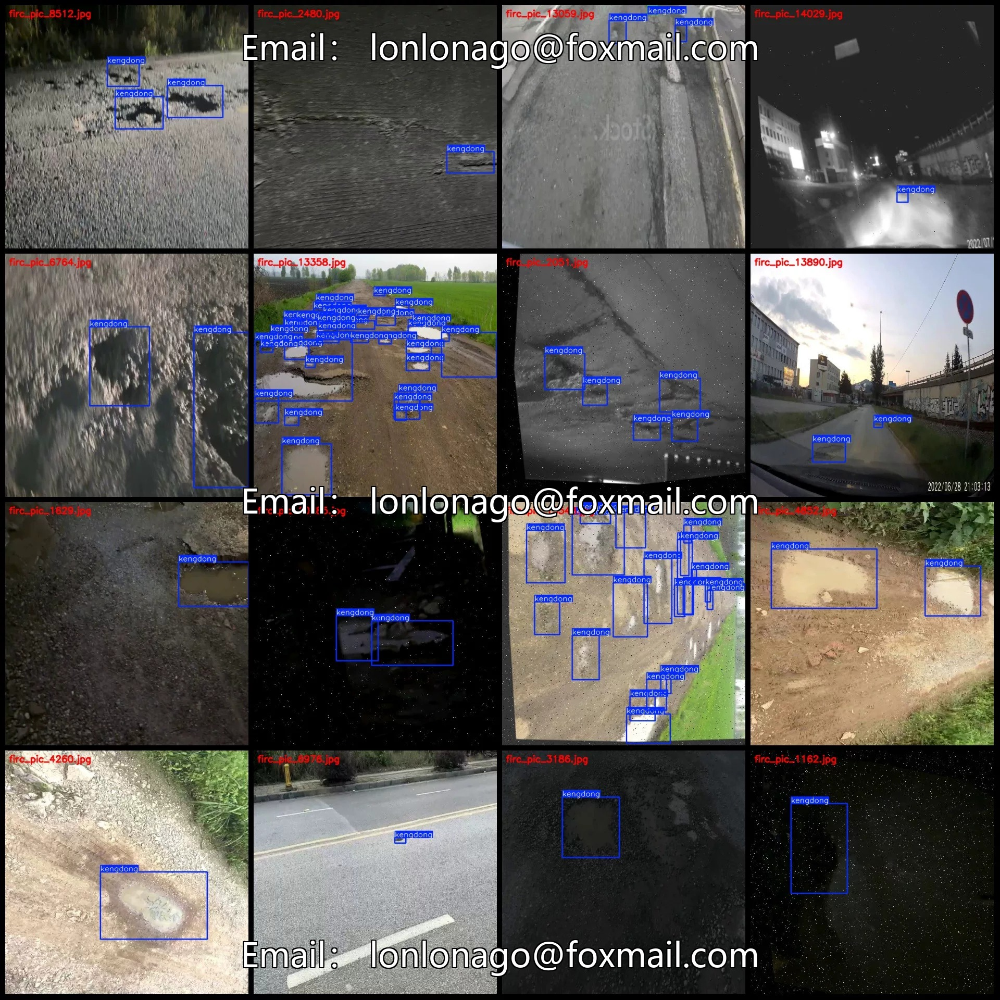
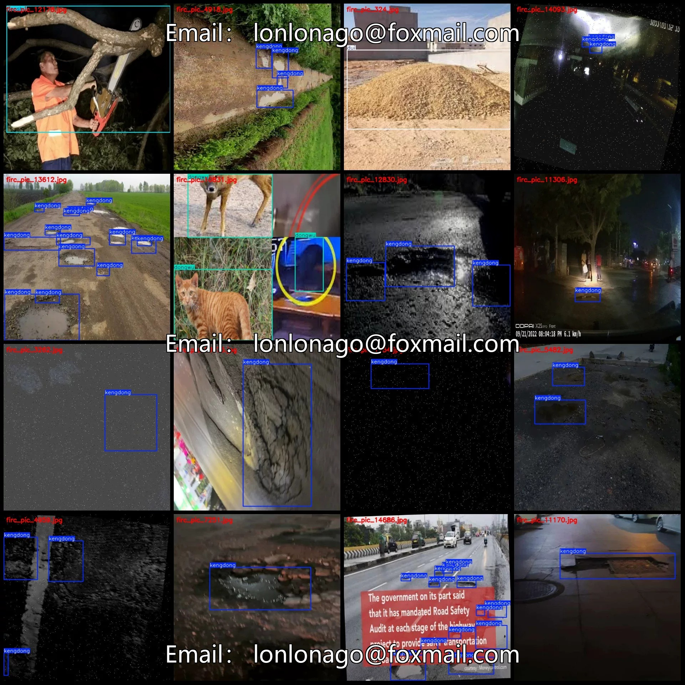
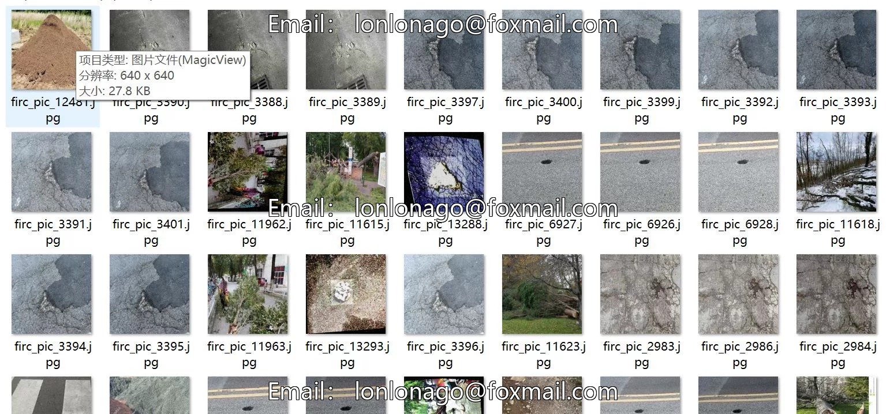
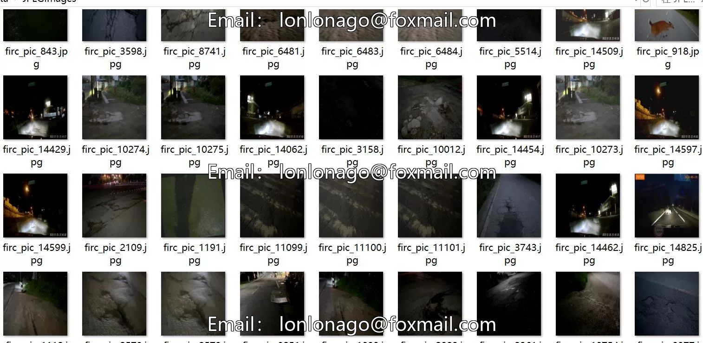

# Road Obstacle Detection Dataset VOC+YOLO format with 14,844 images in 4 categories.

## Body

Road Obstacle Detection Dataset VOC+YOLO Format with 14844 Images in 4 Categories with Enhanced
Warm Reminder: Since the dataset is replicabile, please confirm compliance before purchasing.
Please note that the dataset contains a large number of enhanced images. For details, please refer to the images.
Dataset format: Pascal VOC format + YOLO format (excluding the segmentation path in the txt file, only including jpg images and corresponding VOC format xml files and yolo format txt files)
Number of images (number of jpg files): 14844
Number of annotations (number of xml files): 14844
Number of annotations (number of txt files): 14844
Number of annotation categories: 4

Label category names (Note that the order of categories in the YOLO format does not correspond to this, but is based on the labels folder's classes.txt): ["daoshu", "dongwu", "dui", "kengdong"]
1. Category: "Inverted Tree"
Number of boxes labeled in each category
Daoshu Frame Count = 1075
Dongwu Frames = 2342
Dui Frames = 400
Kendon Frame Count = 34520
Total frame count: 38337
Number of images per category
Daoshu's number of images = 830

Dongwu occupies 892 images
Dui occupies 280 images
Kengdong occupies 12,842 images
Image resolution: 640x640
Labeling tool used: labelImg
Labeling rules: Draw a rectangle around the category
Important note: The dataset does not have separate training, validation, and test sets; you need to partition them yourself.
Special declaration: This dataset does not guarantee the accuracy of the trained models or weight files.

## Images

## Payment

Here is a pay link on Stripe ( https://buy.stripe.com/3cs8yP7sY87d0vu9AB ). Please contact me lonlonago@foxmail.com after funding $89, and I will send you a complete data files , thank you!

